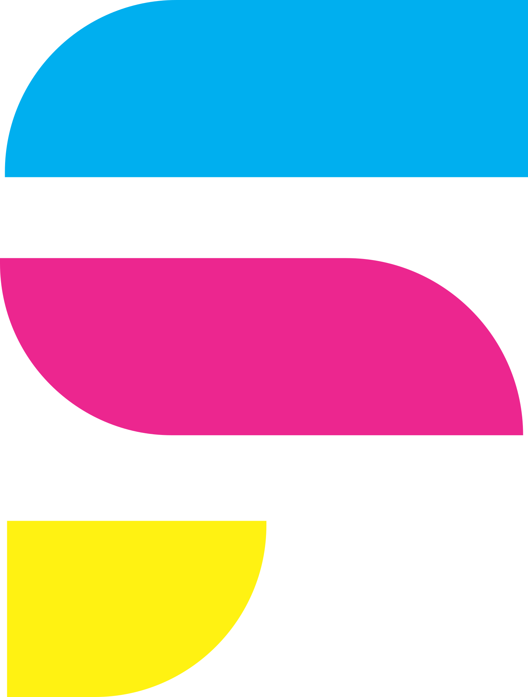

  
  <h1>Fábio Suniga — Landing Page & Portfólio</h1>
  
<strong>Direção de Arte, Design Gráfico e Desenvolvimento Web de Alta Conversão</strong>

  

    
    
    
  

---

## Sobre o Projeto

Landing Page oficial e vitrine interativa de serviços de **Fábio Suniga**, desenvolvida para apresentar soluções de criação de páginas web exclusivas e serviços de Design Gráfico (arte digital, vetorização e materiais impressos no padrão CMYK).

O projeto une referências visuais do universo gráfico — como marcas de corte, barras de calibração e registro CMYK — a uma arquitetura web leve, responsiva e focada em conversão direta via WhatsApp.

---

## Principais Recursos

- **Mostruário Interativo CMYK (Hero):** Apresentação visual construída em código destacando estrutura responsiva, direção de arte e foco em conversão.
- **Simulador de Nichos Ao Vivo:** Vitrine interativa em abas que renderiza três demonstrações reais em HTML/CSS (*Pet Care*, *Imobiliária de Alto Padrão* e *Hamburgueria Artesanal*), demonstrando a adaptação de tipografia, layout e paleta de cores para diferentes segmentos.
- **Vitrine de Serviços Gráficos e Digitais:** Apresentação estruturada de serviços de Landing Pages, posts para redes sociais, vetorização profissional e fechamento de arquivos para impressão.
- **Galeria com Lightbox Nativo:** Exibição do carrossel de apresentação do Instagram utilizando o elemento nativo `<dialog>` para visualização ampliada.
- **Configurador Rápido de Orçamento:** Formulário interativo que monta automaticamente a mensagem personalizada de briefing e redireciona o cliente diretamente para o atendimento no WhatsApp.

---

## Identidade Visual e Paleta de Cores

A interface utiliza tema escuro de alto contraste combinado com a paleta primária CMYK da marca:

| Elemento | Cor | Hexadecimal |
| :--- | :--- | :--- |
| Fundo Principal | Preto Profundo | `#050507` |
| Superfícies / Cards | Grafite Escuro | `#0C0C10` |
| Ciano (C) | Azul Ciano | `#00A8EF` |
| Magenta (M) | Rosa Magenta | `#EC008C` |
| Amarelo (Y) | Amarelo Vibrante | `#FFF200` |

---

## Tecnologias Utilizadas

- **HTML5 Semântico:** Estrutura acessível, uso de `<dialog>` nativo e marcações otimizadas.
- **CSS3 Moderno:** Custom Properties (variáveis CSS), CSS Grid, Flexbox, animações fluidas, personalização nativa de barra de rolagem (`scrollbar-color` / `scrollbar-width`) e design responsivo mobile-first.
- **JavaScript (ES6+ Vanilla):** Controle de abas do simulador de nichos, menu mobile, modal lightbox, botão flutuante reativo ao scroll e gerador dinâmico de link para WhatsApp, sem dependência de bibliotecas externas.

---

## Contato

- **LinkedIn:** [linkedin.com/in/fabio-suniga](https://www.linkedin.com/in/fabio-suniga/)
- **Instagram:** [@fabiosunigadesign](https://www.instagram.com/fabiosunigadesign/)
- **WhatsApp:** [Solicitar Orçamento](https://wa.me/5511953273656)
